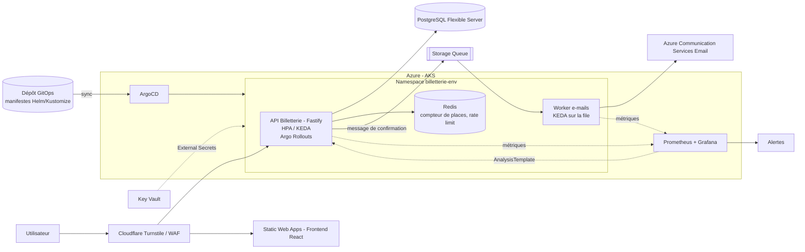

# Proposition de stack, architecture et arborescence – Billetterie (thématique 4)

## 1. Principes directeurs

- Application volontairement simple : l'effort porte sur la chaîne DevOps.
- Socle commun valable quelle que soit la contrainte imposée, avec des « modules d'adaptation » (section 6).
- Choix par défaut : **Azure (AKS managé) + conteneurs portables + Terraform + GitOps avec ArgoCD**.
- ArgoCD impose Kubernetes : Azure Container Apps est donc remplacé par **AKS** (tier Free du control plane, 1 petit nœud) pour garder un coût faible. Cet arbitrage doit faire l'objet d'un ADR.

## 2. Stack proposée

| Domaine | Choix | Justification |
|---|---|---|
| Backend | Node.js + TypeScript (Fastify) | Léger, rapide à écrire, bon écosystème de tests |
| Frontend | React + Vite (statique) | Servi en statique : Azure Static Web Apps (offre gratuite) |
| Base de données | PostgreSQL Flexible Server (Burstable B1ms) | Transactions ACID, `SELECT ... FOR UPDATE` pour l'intégrité des places |
| Cache / file d'attente | Redis (pod Helm Bitnami) + file d'attente Azure Storage Queue | Compteur de places, anti-bot (rate limiting), salle d'attente ; envoi d'e-mails asynchrone |
| Compute | **Azure Kubernetes Service (AKS)**, tier Free, node pool `Standard_B2s` (autoscaler 1..3, Spot possible en staging) | Requis par ArgoCD ; HPA + KEDA (add-on AKS) pour l'autoscaling |
| GitOps | **ArgoCD** (pattern app-of-apps, `ApplicationSet` pour staging/prod) | Le cluster se synchronise depuis Git ; aucun `kubectl` manuel, dérive détectée et corrigée (self-heal) |
| Packaging | Helm (chart de l'app) + Kustomize (overlays staging/prod) | Même chart, valeurs différentes par environnement |
| Déploiement progressif | **Argo Rollouts** (blue/green ou canary + AnalysisTemplate Prometheus) | Rollback automatique si les métriques se dégradent |
| Ingress / TLS | NGINX Ingress (ou App Routing AKS) + cert-manager (Let's Encrypt) | Gratuit |
| Secrets cluster | External Secrets Operator (Key Vault) ou Sealed Secrets | Aucun secret en clair dans le dépôt GitOps |
| Métriques cluster | kube-prometheus-stack (Prometheus + Grafana) | Alimente les dashboards, alertes et analyses de rollout |
| Registre | Azure Container Registry (Basic) ou GHCR | GHCR gratuit si budget quasi nul |
| E-mail | Azure Communication Services Email (prod), Mailpit (dev/staging) | Confirmation de réservation |
| Anti-bot | Cloudflare Turnstile + rate limiting (`@fastify/rate-limit` sur Redis) | Gratuit |
| IaC | Terraform (provider `azurerm`) + backend d'état dans Azure Storage | Tout détruire/recréer en une commande |
| CI/CD | GitHub Actions + OIDC vers Azure (aucun secret long durée) | Gratuit, environnements GitHub avec approbation pour la prod |
| Secrets | Azure Key Vault + GitHub Secrets (OIDC) ; hook `gitleaks` | Aucun secret dans le dépôt |
| Tests unitaires | Vitest | |
| Tests d'intégration | Testcontainers (Postgres + Redis) | Vrai SGBD dans la CI |
| Tests E2E | Playwright | Parcours réservation complet |
| Tests de charge | **k6** (pic d'ouverture des ventes, en CI sur staging) | Seuils (p95, taux d'erreur) = critères de réussite du pipeline |
| SAST | Semgrep (ou CodeQL) | |
| SCA | Trivy fs / `npm audit` / OSV-Scanner + Dependabot | |
| Scan d'images | Trivy image | |
| DAST | OWASP ZAP baseline sur staging | |
| Security gate | Échec si vulnérabilité CRITICAL | |
| Métriques / logs | Prometheus + Loki (ou Azure Monitor Container Insights), OpenTelemetry | Métriques applicatives et cluster |
| Dashboards | Grafana (dans le cluster via kube-prometheus-stack) | Dashboards versionnés en JSON |
| Alerte pertinente | Taux de rejet « plus de places » / latence p95 / 5xx pendant l'ouverture des ventes ; file d'e-mails qui s'accumule | Alerte liée au contexte métier |
| Dev reproductible | Devcontainer + `docker compose` + Makefile | Onboarding rapide |
| Documentation | README, ADR (`docs/adr/`), schémas Mermaid | |

## 3. Architecture



### Intégrité des réservations (point clé)

- Décrément atomique : `UPDATE events SET remaining = remaining - :n WHERE id = :id AND remaining >= :n` dans une transaction.
- Clé d'idempotence par requête de réservation (pas de double réservation sur retry).
- Réservation temporaire (hold de 5 min) puis confirmation ; expiration par tâche planifiée.
- Test d'intégration de concurrence (N requêtes simultanées pour M places, jamais de survente).

### Pipeline CI/CD

```mermaid
flowchart LR
    A[Push / PR] --> B[Pre-commit: gitleaks]
    B --> C[Lint + Build]
    C --> D[Tests unitaires]
    D --> E[Tests d'intégration - Testcontainers]
    C --> S1[SAST Semgrep]
    C --> S2[SCA Trivy/OSV]
    C --> IMG[Build image Docker]
    IMG --> S3[Scan image Trivy]
    E --> G{Security gate\nCRITICAL = échec}
    S1 --> G
    S2 --> G
    S3 --> G
    G --> P[Push image taggée SHA/semver vers registre]
    P --> GO[Commit auto du nouveau tag dans le dépôt GitOps\noverlay staging]
    GO --> AS[ArgoCD synchronise STAGING]
    AS --> E2E[Playwright E2E]
    AS --> LT[k6 test de charge]
    AS --> ZAP[ZAP DAST]
    E2E --> AP{Approbation manuelle\nou tag de release}
    LT --> AP
    ZAP --> AP
    AP --> GP[PR/commit GitOps overlay prod]
    GP --> AD[ArgoCD synchronise PROD\nArgo Rollouts: canary / blue-green]
    AD --> HC{AnalysisTemplate OK ?\nerreurs 5xx, latence p95}
    HC -- non --> RB[Rollback auto Argo Rollouts\n+ git revert]
    HC -- oui --> DONE[Terminé]
```



- Stratégie Git : **trunk-based** (branches courtes, PR obligatoire, CI verte requise, protection de `main`).
- Séparation CI / CD : la CI GitHub Actions construit, teste, scanne et pousse l'image, puis met à jour le tag dans `gitops/`. ArgoCD (pull) déploie ; la CI n'a aucun accès `kubectl` au cluster.
- Environnements : `staging` et `prod`, même module Terraform (`envs/*.tfvars`) et même chart Helm avec overlays Kustomize (`gitops/overlays/staging|prod`). Terraform crée AKS et installe ArgoCD ; ArgoCD installe le reste (app-of-apps).
- Promotion : staging automatique ; prod via PR GitOps approuvée (ou tag de release).
- Rollback : automatique via Argo Rollouts (analyse de métriques) ; manuel via `git revert` du commit GitOps ou `argocd app rollback`.

## 4. Arborescence

```
billetterie/
├── README.md
├── Makefile                      # make up / test / deploy / destroy
├── .devcontainer/
│   └── devcontainer.json
├── .pre-commit-config.yaml       # gitleaks, lint
├── .gitleaks.toml
├── docker-compose.yml            # dev local : api, worker, postgres, redis, mailpit
├── .github/
│   ├── dependabot.yml
│   ├── CODEOWNERS
│   └── workflows/
│       ├── ci.yml                # build, tests, SAST, SCA, image, security gate
│       ├── promote-staging.yml   # bump du tag GitOps staging, puis e2e + k6 + zap
│       ├── promote-prod.yml      # approbation, PR GitOps vers prod
│       ├── infra.yml             # terraform plan/apply (AKS + bootstrap ArgoCD)
│       └── destroy.yml           # nettoyage / extinction des environnements
├── apps/
│   ├── api/
│   │   ├── Dockerfile            # multi-stage, image distroless/alpine, non-root
│   │   ├── package.json
│   │   ├── src/
│   │   │   ├── routes/           # events, reservations, health
│   │   │   ├── services/         # logique de réservation (transactions)
│   │   │   ├── plugins/          # rate-limit, turnstile, otel
│   │   │   └── db/migrations/    # migrations automatisées
│   │   └── tests/
│   │       ├── unit/
│   │       └── integration/      # Testcontainers, test de concurrence
│   ├── worker/
│   │   ├── Dockerfile
│   │   └── src/                  # consommation de la file, envoi d'e-mails
│   └── web/
│       ├── package.json
│       └── src/
├── tests/
│   ├── e2e/                      # Playwright
│   └── load/
│       └── open-sales.k6.js      # scénario pic d'ouverture + seuils
├── infra/
│   ├── bootstrap/                # backend d'état Terraform (storage account)
│   ├── modules/
│   │   ├── network/
│   │   ├── database/             # PostgreSQL Flexible Server
│   │   ├── aks/                  # cluster, node pool, add-on KEDA, identité workload
│   │   ├── argocd-bootstrap/     # installation ArgoCD (Helm) + app racine
│   │   ├── registry/
│   │   ├── keyvault/
│   │   ├── queue/
│   │   └── static-web/
│   ├── envs/
│   │   ├── staging.tfvars
│   │   └── prod.tfvars
│   ├── main.tf
│   ├── variables.tf
│   ├── outputs.tf
│   └── providers.tf
├── gitops/                       # source de vérité lue par ArgoCD
│   ├── bootstrap/
│   │   └── root-app.yaml         # app-of-apps
│   ├── apps/                     # Applications / ApplicationSet ArgoCD
│   │   ├── billetterie.yaml
│   │   ├── platform.yaml         # ingress, cert-manager, external-secrets, KEDA
│   │   └── monitoring.yaml       # kube-prometheus-stack
│   ├── charts/billetterie/       # chart Helm (api, worker, redis, rollout, HPA/KEDA)
│   └── overlays/
│       ├── staging/              # tag d'image, replicas, ressources
│       └── prod/
├── observability/
│   ├── grafana/dashboards/       # JSON versionnés
│   ├── alerts/                   # PrometheusRule
│   └── analysis-templates/       # AnalysisTemplate Argo Rollouts
├── security/
│   ├── semgrep-rules/
│   ├── trivy.yaml
│   └── zap-baseline.conf
├── scripts/
│   ├── bootstrap.sh              # création du backend Terraform + OIDC
│   ├── smoke-test.sh
│   └── rollback.sh
└── docs/
    ├── adr/
    │   ├── 0001-container-apps-vs-aks.md
    │   ├── 0002-trunk-based.md
    │   ├── 0003-postgres-transactions-vs-redis-lock.md
    │   └── ...
    ├── architecture.md           # schémas
    ├── pipeline.md
    ├── runbook.md
    └── finops/finops.md          # coûts estimés
```

## 5. Pourquoi ce choix pour cette thématique

- **Pics à l'ouverture des ventes** : HPA + KEDA montent en charge sur le CPU, les requêtes HTTP et la longueur de file ; Cluster Autoscaler ajoute des nœuds ; Redis absorbe les lectures et le rate limiting ; k6 valide en CI.
- **Intégrité** : source de vérité unique dans PostgreSQL, transactions atomiques, idempotence.
- **Bots** : Turnstile + rate limiting.
- **GitOps** : ArgoCD donne un déploiement déclaratif, auditable (tout est un commit), avec détection de dérive et rollback par `git revert`.
- **Compromis Kubernetes** : complexité et coût plus élevés que Container Apps. À justifier dans un ADR (ArgoCD demandé, AKS Free + nœud unique pour limiter le coût, `az aks stop` hors démo).

## 6. Modules d'adaptation selon la contrainte tirée

| # | Contrainte | Adaptation à ajouter |
|---|---|---|
| 1 | Montée en charge imprévisible | Déjà central : HPA + KEDA + Cluster Autoscaler, k6 avec seuils bloquants, cache Redis, CDN devant le frontend, salle d'attente |
| 2 | Équipe 100 % développeurs | Charts Helm simples, ArgoCD (UI), Terraform, Makefile, runbook ; justifier la charge Kubernetes (ou AKS Automatic) |
| 3 | Disponibilité 99,999 % | AKS tier Standard (SLA), nœuds sur 3 zones, PostgreSQL HA zone-redundant, `replicas >= 2` + PodDisruptionBudget, probes, Argo Rollouts, Azure Front Door multi-région ; documenter honnêtement le coût et le SLA composite |
| 4 | Budget quasi nul | AKS tier Free, 1 nœud B2s (Spot en staging), `az aks stop` hors démo, GHCR au lieu d'ACR, Static Web Apps Free, PostgreSQL B1ms arrêté hors heures, Mailpit en staging, un seul cluster avec 2 namespaces, budget Azure + alerte de coût (`azurerm_consumption_budget`), `docs/finops/finops.md` |
| 5 | MVP rapide | Pipeline minimal mais complet, feature flags (variables d'env / Unleash), un seul service si besoin (worker intégré à l'API) |
| 6 | Latence mondiale | Azure Front Door/Cloudflare CDN, 2 clusters AKS pilotés par un seul ArgoCD (ApplicationSet multi-cluster), lecture répliquée PostgreSQL, k6 depuis plusieurs régions |
| 7 | Legacy | Couche d'adaptation (anti-corruption layer), faux legacy simulé (conteneur SQL Server/Oracle XE ou mainframe mock), tests d'intégration contractuels |
| 8 | Conformité (RGPD, HDS, DSP2) | Policy as Code (Azure Policy + OPA/Conftest sur Terraform), chiffrement (CMK Key Vault), logs d'audit, rétention configurée |
| 9 | Anonymisation totale | Pseudonymisation (hash salé) avant écriture, données de test synthétiques (Faker), filtre de logs, test CI qui détecte les données personnelles dans les logs |
| 10 | Souveraineté France/Europe | Régions `francecentral`/`westeurope`, Azure Policy « allowed locations », Conftest qui échoue si région hors UE, éviter Cloudflare hors UE (alternative : Azure Front Door ou rien) |
| 11 | Multi-cloud | Conteneurs portables, PostgreSQL standard, Terraform multi-providers (Azure + Scaleway/OVH), abandonner Storage Queue au profit de Redis/RabbitMQ, pas de service propriétaire |
| 12 | On-premise | Pas d'Azure pour l'exécution : VMs + Ansible qui installe k3s, ArgoCD inchangé, registre Harbor, Prometheus/Loki/Grafana auto-hébergés ; VMs locales (Vagrant/Multipass) pour la démo |
| 13 | Plusieurs prod/jour | Pipeline < 10 min, tests parallélisés, canary/blue-green Argo Rollouts, auto-sync ArgoCD, feature flags |
| 14 | Green IT | Extinction automatique de staging (workflow planifié, KEDA scale-to-zero), images distroless, région à faible carbone, mesure (Kepler ou Azure Carbon Optimization) |
| 15 | Edge / hors-ligne | Frontend PWA + file locale (IndexedDB), synchronisation avec idempotence, nœuds distants k3s pilotés par ArgoCD (pull, tolère la connectivité intermittente), mises à jour à distance |
| 16 | Cible de cyberattaques | Azure Front Door WAF, DAST (ZAP) bloquant, durcissement (images non-root, read-only FS), Defender for Cloud, runbook d'incident |
| 17 | Multi-tenant | `tenant_id` + Row Level Security PostgreSQL, déploiement paramétré (Terraform `for_each` par client), quotas par client |
| 18 | Volumes massifs | Stockage objet (Blob) pour archives et exports, partitionnement PostgreSQL, sauvegardes et restauration testées automatiquement, cycle de vie des données |
| 19 | Équipe multi-fuseaux | Revue asynchrone (PR templates, CODEOWNERS), ChatOps (notifications Teams/Slack, déploiement par commande), runbooks, alerting avec astreinte |
| 20 | Fort turnover | Devcontainer, `make up`, README + ADR, script `bootstrap.sh`, tout scripté |

## 7. Ordre de réalisation conseillé (5 jours)

1. Jour 1 : app minimale, Docker/Compose, devcontainer, pre-commit, stratégie de branches, ADR initiaux.
2. Jour 2 : CI (build, unit, intégration), registre, SAST/SCA/scan d'images, security gate.
3. Jour 3 : Terraform (AKS + bootstrap ArgoCD), OIDC, chart Helm, overlays staging/prod, sync automatique, health checks.
4. Jour 4 : E2E, k6, ZAP, promotion GitOps/approbation, Argo Rollouts + rollback, observabilité (dashboard + alerte).
5. Jour 5 : module d'adaptation à la contrainte tirée, README, schémas, répétition de la démo.
